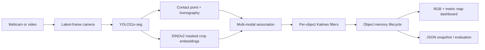

# ObjectHunter

ObjectHunter is a one-day MVP for **uncertainty-aware object-centric spatial memory** from a single RGB webcam. It detects COCO objects, extracts appearance features, projects tabletop contact points into metric coordinates, associates observations with a custom Hungarian matcher, and maintains persistent object identities through occlusion and re-identification.

## Architecture



## Algorithms

Each object uses state `x=[x,y,vx,vy]`. A constant-velocity transition is used with continuous white-acceleration covariance:

`F=[[1,0,dt,0],[0,1,0,dt],[0,0,1,0],[0,0,0,1]]`

`Q=q[[dt⁴/4,0,dt³/2,0],[0,dt⁴/4,0,dt³/2],[dt³/2,0,dt²,0],[0,dt³/2,0,dt²]]`.

The measurement is `[x,y]`. Joseph-form covariance correction keeps the covariance numerically stable. 95% ellipses use the 2-D chi-square value 5.991. Association combines appearance cost `1-cosine`, normalized Mahalanobis distance, and `1-IoU`, with default weights 0.55/0.35/0.10 and a 9.21 squared Mahalanobis gate. Dormant re-identification uses gallery similarity and semantic compatibility without stale-position gating.

## Setup

Python 3.11+ is recommended (Python 3.12 also works). Create an environment and install the core:

```powershell
python -m venv .venv
.\.venv\Scripts\Activate.ps1
pip install -r requirements.txt
pip install torch torchvision ultralytics transformers Pillow
```

For a CUDA-enabled PyTorch wheel, follow the current PyTorch installation selector for the installed NVIDIA driver. `check_system.py` reports whether CUDA is usable. The detector and embedder are optional at import time; unit tests run without them.

On the current Windows machine, the default Python environment has the full CPU package stack, while the existing ComfyUI venv provides CUDA Torch 2.11.0+cu128 and sees the RTX 4060 Ti. The local `yolo11n-seg.pt` and `models/dinov2-small` assets are downloaded and verified. Use `scripts/run_gpu.ps1` for the validated CUDA path; the ordinary Python commands retain automatic CPU fallback.

## Run

```powershell
python scripts/check_system.py
python scripts/calibrate_camera.py --camera 0
python scripts/run_demo.py --camera 0 --device cuda
python scripts/run_demo.py --source assets/demo.mp4
python scripts/evaluate.py --config configs/default.yaml
python -m pytest tests -q
```

On this machine, the verified CUDA environment is the existing ComfyUI venv. Use the convenience launcher to run the neural demo on the RTX 4060 Ti:

```powershell
powershell -ExecutionPolicy Bypass -File scripts/run_gpu.ps1 --camera 0 --device cuda
```

To track exactly one item, use single-target mode. At startup it asks what item to look for, then locks onto the first visible matching object, ignores all other detections, and shows the target location in both the dashboard and console:

```powershell
powershell -ExecutionPolicy Bypass -File scripts/run_gpu.ps1 --camera 0 --device cuda --single-target
```

For an unattended launch, provide the class directly with `--target-class cup`. With calibration, locations are `(x, y)` meters on the tabletop; without calibration they are image pixels. If the target disappears briefly, its location is predicted; after the dormant timeout, the last reliable location is reported.

Calibration selects four tabletop corners in image order and maps them to a rectangle in meters. If no calibration file exists, the demo remains image-space and the map should be interpreted as pixels; this MVP does not estimate unrestricted 3-D height, perform moving-camera SLAM, or infer depth behind occluders.

For cameras with noticeable lens distortion, `objecthunter.geometry.undistort_frame` and `undistort_pixels` accept a standard OpenCV intrinsic matrix and distortion coefficients before applying the saved homography.

Dashboard keys: `Q` quit, `P` pause, `R` reset memory, `S` save screenshot, `M` export `outputs/world_model.json`, and `V` toggles `outputs/dashboard.mp4` recording.

For a guided desktop UI, use:

```powershell
powershell -ExecutionPolicy Bypass -File scripts/run_ui_gpu.ps1 --camera 0 --device cuda
```

Enter the requested item in the `Item to find` field and press `Start tracking`. The UI provides the live camera view, target mask/bounding box, target ID, current location, lifecycle state, latency/FPS/GPU metrics, and a top-down map.

### MuJoCo virtual-camera simulation

For a repeatable 3-D scene without a physical camera, the project includes a MuJoCo world with a desk, cup, bottle, book, keys, and a fixed RGB camera. The cup disappears for a planned occlusion interval and then reappears at a new time step. MuJoCo produces the RGB video; the simulation runner uses timestamped simulator ground truth as a controlled detector input so tracker and memory behavior can be evaluated independently of YOLO model bias.

Use the project `.venv` through the launcher:

```powershell
powershell -ExecutionPolicy Bypass -File scripts/run_mujoco.ps1 -Mode generate
powershell -ExecutionPolicy Bypass -File scripts/run_mujoco.ps1 -Mode run -TargetClass cup -Headless
```

For the interactive platform, launch the live MuJoCo lab:

```powershell
powershell -ExecutionPolicy Bypass -File scripts/run_mujoco.ps1 -Mode ui
```

Enter `cup`, `bottle`, `book`, or `keys`, then press `Start`. The window contains a live virtual-camera view, the target's metric tabletop location, lifecycle state, trajectory, velocity, and covariance ellipse. Use `Move left`, `Move right`, `Occlude`, and `Reveal` to exercise motion, prediction, and re-identification. `Reset` starts a fresh session and `Stop` pauses processing.

The interactive lab uses MuJoCo's rendered scene and simulator geometry as the detection source so the spatial-memory and UI behavior can be tested deterministically without a webcam. The prerecorded replay command above additionally exercises ObjectHunter's video-input path. Neural YOLO/DINO inference remains available through `scripts/run_demo.py` for real camera or video validation.

The run generates `assets/mujoco_scene.mp4`, `assets/mujoco_ground_truth.jsonl`, `assets/mujoco_tabletop.xml`, and `outputs/mujoco_dashboard.mp4`. The validated run processed 480 virtual-camera frames at 30 FPS, preserved persistent ID 1, and recorded one successful re-identification after occlusion. This mode validates spatial memory and tracking; it does not measure YOLO/DINO detection accuracy. To experiment with the neural detector on the rendered video, use `scripts/run_gpu.ps1 --source assets/mujoco_scene.mp4 --device cuda`, but treat that as a separate detector experiment.

To create the self-contained architecture/validation explainer video included in the local `outputs/` folder:

```powershell
python scripts/create_demo_video.py --output outputs/objecthunter_demo.mp4 --seconds 46
```

This video is a synthetic visualization of the pipeline and measured core-validation results. It is not a webcam recording and does not claim live-camera accuracy. A live dashboard recording requires a connected camera and a desktop session where the OpenCV window is visible; press `V` in the dashboard to start/stop recording.

## Validation and limitations

Run the deterministic validation benchmark with:

```powershell
python scripts/evaluate.py --config configs/default.yaml --output outputs/evaluation.json
python -m pytest tests -q
```

The benchmark uses a fixed random seed (`2026`) and synthetic observations so that the non-neural core can be checked reproducibly. It measures independent homography validation points, Kalman position error and uncertainty growth during an occlusion, identity consistency under detection-order changes, dormant-object re-identification, and tracker-core throughput.

Measured locally in the Python 3.12 environment:

| Validation | Quantified result |
| --- | ---: |
| Unit tests | 10 passed |
| Homography independent validation | 3 points; 2.61e-8 m world RMSE |
| Homography pixel round-trip | 3.60e-13 px maximum error |
| Kalman position error | 0.00872 m RMSE after 20-frame warm-up |
| Ten-frame occlusion prediction | 0.00626 m RMSE |
| Position covariance trace during occlusion | 5.26x growth |
| Two-object association identity consistency | 100% over 60 frames |
| Dormant re-identification | 1/1 success; persistent ID preserved |
| Deterministic tracker core | 2,975.8 updates/s for 300 two-object frames |

These numbers validate geometry, filtering, association, and memory logic only; they are not end-to-end neural-camera performance. YOLO/DINO latency, GPU memory, IDF1, ID switches, real-scene metric localization error, and camera robustness require annotated replay data or a connected camera and are intentionally not fabricated here.

The webcam, YOLO weights, and DINOv2 weights are not bundled. A stationary camera and planar workspace are assumptions. Camera exposure changes, severe occlusion, identical objects, lens distortion, and crowded scenes need further validation.

## Attribution and licensing

YOLO11 and DINOv2 are loaded from their public upstream distributions at runtime. Check the respective Ultralytics and Meta/Hugging Face model and software licenses before redistribution. OpenCV, NumPy, SciPy, PyYAML, PyTorch, Transformers, and pytest retain their upstream licenses.
