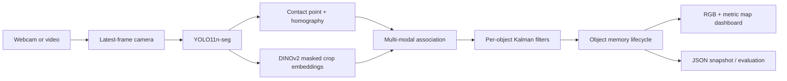

# ObjectHunter

ObjectHunter is a one-day MVP for **uncertainty-aware object-centric spatial memory** from a single RGB webcam. It detects COCO objects, extracts appearance features, projects tabletop contact points into metric coordinates, associates observations with a custom Hungarian matcher, and maintains persistent object identities through occlusion and re-identification.

## Architecture



## Algorithms

Each object uses state `x=[x,y,vx,vy]`. A constant-velocity transition is used with continuous white-acceleration covariance:

`F=[[1,0,dt,0],[0,1,0,dt],[0,0,1,0],[0,0,0,1]]`

`Q=q[[dt⁴/4,0,dt³/2,0],[0,dt⁴/4,0,dt³/2],[dt³/2,0,dt²,0],[0,dt³/2,0,dt²]]`.

The measurement is `[x,y]`. Joseph-form covariance correction keeps the covariance numerically stable. 95% ellipses use the 2-D chi-square value 5.991. Association combines appearance cost `1-cosine`, normalized Mahalanobis distance, and `1-IoU`, with default weights 0.55/0.35/0.10 and a 9.21 squared Mahalanobis gate. Dormant re-identification uses gallery similarity and semantic compatibility without stale-position gating.

## Setup

Python 3.11+ is recommended (Python 3.12 also works). Create an environment and install the core:

```powershell
python -m venv .venv
.\.venv\Scripts\Activate.ps1
pip install -r requirements.txt
pip install torch torchvision ultralytics transformers Pillow
```

For a CUDA-enabled PyTorch wheel, follow the current PyTorch installation selector for the installed NVIDIA driver. `check_system.py` reports whether CUDA is usable. The detector and embedder are optional at import time; unit tests run without them.

On the current Windows machine, the default Python environment has the full CPU package stack, while the existing ComfyUI venv provides CUDA Torch 2.11.0+cu128 and sees the RTX 4060 Ti. The local `yolo11n-seg.pt` and `models/dinov2-small` assets are downloaded and verified. Use `scripts/run_gpu.ps1` for the validated CUDA path; the ordinary Python commands retain automatic CPU fallback.

## Run

```powershell
python scripts/check_system.py
python scripts/calibrate_camera.py --camera 0
python scripts/run_demo.py --camera 0 --device cuda
python scripts/run_demo.py --source assets/demo.mp4
python scripts/evaluate.py --config configs/default.yaml
python -m pytest tests -q
```

On this machine, the verified CUDA environment is the existing ComfyUI venv. Use the convenience launcher to run the neural demo on the RTX 4060 Ti:

```powershell
powershell -ExecutionPolicy Bypass -File scripts/run_gpu.ps1 --camera 0 --device cuda
```

To track exactly one item, use single-target mode. At startup it asks what item to look for, then locks onto the first visible matching object, ignores all other detections, and shows the target location in both the dashboard and console:

```powershell
powershell -ExecutionPolicy Bypass -File scripts/run_gpu.ps1 --camera 0 --device cuda --single-target
```

For an unattended launch, provide the class directly with `--target-class cup`. With calibration, locations are `(x, y)` meters on the tabletop; without calibration they are image pixels. If the target disappears briefly, its location is predicted; after the dormant timeout, the last reliable location is reported.

Calibration selects four tabletop corners in image order and maps them to a rectangle in meters. If no calibration file exists, the demo remains image-space and the map should be interpreted as pixels; this MVP does not estimate unrestricted 3-D height, perform moving-camera SLAM, or infer depth behind occluders.

For cameras with noticeable lens distortion, `objecthunter.geometry.undistort_frame` and `undistort_pixels` accept a standard OpenCV intrinsic matrix and distortion coefficients before applying the saved homography.

Dashboard keys: `Q` quit, `P` pause, `R` reset memory, `S` save screenshot, `M` export `outputs/world_model.json`, and `V` toggles `outputs/dashboard.mp4` recording.

For a guided desktop UI, use:

```powershell
powershell -ExecutionPolicy Bypass -File scripts/run_ui_gpu.ps1 --camera 0 --device cuda
```

Enter the requested item in the `Item to find` field and press `Start tracking`. The UI provides the live camera view, target mask/bounding box, target ID, current location, lifecycle state, latency/FPS/GPU metrics, and a top-down map.

## Evaluation and limitations

The included tests cover homography, Kalman behavior, association gates, missing embeddings, lifecycle transitions, re-identification, and ambiguity. `evaluate.py` currently writes a reproducible Kalman smoke benchmark. IDF1, ID switches, re-identification rate, localization error, and ablations require annotated replay data and are intentionally reported as unavailable rather than fabricated.

The webcam, YOLO weights, and DINOv2 weights were not bundled or claimed as tested in this repository. A stationary camera and planar workspace are assumptions. Camera exposure changes, severe occlusion, identical objects, lens distortion, and crowded scenes need further validation.

## Interview summary

The key engineering trade-off is a robust 2-D metric tabletop memory instead of pretending a monocular webcam provides full 3-D reconstruction. Neural perception is isolated behind detector/embedder interfaces, while geometry, filtering, association, and lifecycle memory are deterministic and testable. The latest-frame buffer bounds latency; Kalman prediction bridges short occlusions; galleries and dormant matching preserve identity after disappearance; and uncertainty is shown explicitly with covariance ellipses.

## Attribution and licensing

YOLO11 and DINOv2 are loaded from their public upstream distributions at runtime. Check the respective Ultralytics and Meta/Hugging Face model and software licenses before redistribution. OpenCV, NumPy, SciPy, PyYAML, PyTorch, Transformers, and pytest retain their upstream licenses.
